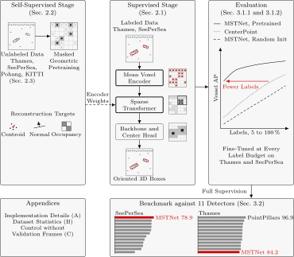

# MSTNet: Label-Efficient Maritime 3D LiDAR Object Detection by Self-Supervised Pretraining

Code, configurations and results for the paper of the same name.

Tim Rehbronn, Laurens Keuker, Chih-Chun Chen, Christopher Schulte, Heike Vallery
Institute of Automatic Control, RWTH Aachen University

[Reproduce](docs/REPRODUCE.md) · [Environments](docs/ENVIRONMENTS.md) · [Data](data/README.md) · [Third-party code](THIRD_PARTY.md)

The pipeline is called **MSTNet** in the paper and throughout this repository.

The code was written by Tim Rehbronn and Laurens Keuker, with coding assistance and refactoring by Anthropic's Claude.

## Abstract

> Maritime autonomous vessels often rely on 3D object detection, but supervised
> training requires resource-intensive annotations, while unlabeled LiDAR
> recordings are increasingly available. To utilize these recordings, this work
> introduces the Maritime Sparse Transformer Network (MSTNet), a 3D LiDAR detection
> pipeline that combines self-supervised pretraining with supervised fine-tuning.
> In the CenterPoint baseline, a parameter-free mean voxel encoder replaces the
> Pillar Feature Net, and a Single-Stride Sparse Transformer, pretrained with a
> masked geometric objective, replaces the scatter operation. The pipeline is
> evaluated at six label budgets on SeePerSea and a temporally re-split Thames
> dataset with in-domain, cross-domain maritime, and automotive pretraining data,
> and compared with eleven state-of-the-art detectors. On the sparse SeePerSea
> dataset, pretraining increases the mean average precision (mAP) of MSTNet at
> every budget, by 5.80 to 8.78 in the bird's-eye view (BEV) and by 6.91 to 16.52
> in 3D. With 20 % of the annotations, pretrained MSTNet exceeds the 3D mAP of
> fully supervised CenterPoint, and automotive scans also yield a gain. On the
> denser Thames dataset, the improvement is limited to 5 % of the annotations,
> with 5.02 in BEV and 5.75 in 3D, and cross-domain maritime pretraining tends to
> outperform in-domain pretraining. Pretrained MSTNet ranks first in BEV on
> SeePerSea with 78.90 mAP and second in 3D, 0.54 below VoxelNeXt. On Thames,
> PointPillars leads with 96.85 mAP in BEV, and pretrained MSTNet remains below
> every detector with 84.17. The point density, measurable without labels,
> indicates the benefit of pretraining. The code, the frame lists, and the
> checkpoints are publicly available.



## What this is

Annotating maritime LiDAR point clouds is expensive; recording them is not. MSTNet
uses the unlabeled recordings in a pipeline built from published modules. The
detector is CenterPoint with two modules exchanged: a mean voxel encoder replaces
the learned pillar features, and a single-stride sparse transformer builds the
bird's-eye feature map. That transformer is pretrained on unlabeled point clouds
with masked geometric pretraining (GeoMAE): 70 % of the occupied pillars are masked,
and the encoder learns to reconstruct their centroids, surface normals and sub-voxel
occupancy. The pretrained weights then initialize supervised training, which we run
at label budgets from 5 % to 100 % to measure how much annotation the pretraining
replaces, and with pretraining data from inside and outside the target domain
(Thames, SeePerSea, Pohang Canal, KITTI) to measure how far from the target domain
the unlabeled data may come.

The paper closes with a benchmark under one shared protocol. Eleven published
detector configurations (PointPillars, SECOND, CenterPoint, Voxel R-CNN, PV-RCNN,
DSVT in its pillar and voxel form, VoxelNeXt, TransFusion, TED-S, LION-Mamba) and
MSTNet are trained on the rebuilt Thames split and on the 360° point-cloud
annotations of SeePerSea, with every deviation from that protocol documented and
machine-checked.

## Repository structure

```
OpenPCDet/  TED/  LION/  GeoMAE/   the four vendored forks; each carries a CHANGES.md
                                   naming its upstream commit and every file we changed
scripts/                           data preparation, checks, runners, evaluation and
                                   reporting; every entry point lives here
data/                              built locally from the public releases; only the split
                                   index files under custom_*/ImageSets ship
release_data/                      the frame lists in the identifiers of the public
                                   releases and the mAP of every reported run
envs/                              conda exports and pip freezes of the three environments
docs/                              REPRODUCE.md and ENVIRONMENTS.md
results/                           not shipped; where the reporting scripts write the
                                   collected measurements and the generated tables
assets/                            the graphical abstract, SVG and TikZ source
```

OpenPCDet hosts nine of the eleven published detectors and MSTNet itself. TED and
LION are separate forks because each patches into its own copy of the `pcdet`
package. GeoMAE hosts the self-supervised pretraining and runs on an older torch
generation. The forks reach the data tree through relative symlinks, so a clone
works wherever it is placed.

## Installation

Three conda environments, because the detection frameworks run on torch 2.3 while
the pretraining is mmdetection3d-generation code on torch 2.0.
[docs/ENVIRONMENTS.md](docs/ENVIRONMENTS.md) explains the split and gives the build
commands for the compiled ops of each fork.

```bash
conda env create -n pcdet  -f envs/env_pcdet.yml
conda env create -n lion   -f envs/env_lion.yml
conda env create -n geomae -f envs/env_geomae.yml
```

Everything under `scripts/` runs on the interpreter it is started with, which should
be `pcdet`. The two others are announced through environment variables; no script
contains an absolute interpreter path.

```bash
export LION_PYTHON=~/miniconda3/envs/lion/bin/python
export GEOMAE_PYTHON=~/miniconda3/envs/geomae/bin/python
```

## Data

Obtain the four public releases from their authors as described in
[data/README.md](data/README.md), place them under `data/raw/`, then build
everything derived from them. Of SeePerSea, both the aggregated release (point
clouds) and the separated release (360° annotations) are required. The ordered
command list is in [docs/REPRODUCE.md](docs/REPRODUCE.md). This repository
redistributes no dataset content; what it publishes are the split index files, the
frame lists in `release_data/`, and the scripts that build them, so the partition
can be reproduced without the recordings changing hands.

## Usage

**Check** before any GPU hour is spent. `check_configs.py` resolves every training
configuration and reports deviations from the shared protocol, and should print
`no deviations`. `check_training.py` runs static checks over splits, intensity scales
and leftovers.

```bash
python scripts/check_configs.py
python scripts/check_training.py
```

**Train.** The seven self-supervised runs first, then the supervised campaign of 165
runs, about 545 GPU-hours on two RTX 4090. `run_campaign.py --list` reports only the
runs it can start immediately, 98 of them before any pretraining checkpoint exists, and
grows toward the full 165 as `checkpoints/` fills in. Both runners drive two GPUs,
record every result, and skip finished work on restart, so they can be stopped and
resumed at will.

```bash
python scripts/run_pretraining_all.py                        # writes checkpoints/
python scripts/run_campaign.py --list                        # the plan, trains nothing
setsid nohup python scripts/run_campaign.py --go > runs/campaign.log 2>&1 &
```

**Report.** Measure the inference cost once the campaign has finished, then generate
the tables, figures and further measurements of the paper.

```bash
python scripts/run_speed_sweep.py --go               # parameters, latency, peak memory
python scripts/make_paper_tables.py                  # Figures 6 and 7, Tables 3 to 5 and C1
python scripts/export_train_loss.py                  # training loss behind the learning rate
python scripts/measure_localization_error.py         # localization of the matched detections
python scripts/analyze_seepersea_matches.py          # recall by vessel length and neighbourhood
python scripts/dataset_statistics.py --grid-search   # Appendices A.1 and B.3
```

## Results

The mAP of every run the paper reports is in `release_data/results/map_per_run.csv`;
the means over the runs of a cell reproduce the tables and figures of the paper.
`make_paper_tables.py` writes the same file from the records of a new campaign,
together with every table and figure of the results, into `results/`. None is
written by hand, so a rerun of a cell cannot leave a table disagreeing with the
records.

## Checkpoints

The pretrained encoders and the trained detector weights are published separately
on Zenodo, one checkpoint per reported run, with a table that maps each file to its
experiment and configuration.

> **DOI:** [10.5281/zenodo.22825184](https://doi.org/10.5281/zenodo.22825184)

`scripts/make_checkpoint_release.py` assembles that folder from the run records, so
the path from a published checkpoint back to the number it produced is itself
reproducible.

### Using the published checkpoints

Downloading a checkpoint from Zenodo replaces the GPU-hours it was trained for,
not the data: the datasets still have to be obtained and converted as described
in [Data](#data) and [docs/REPRODUCE.md](docs/REPRODUCE.md), because every config
reads its input from `data/custom_london/` or `data/custom_seepersea/`, not from
the checkpoint. Two things become possible once that data tree exists and a
checkpoint is downloaded.

**Skip pretraining.** The Zenodo `pretraining/` files are exactly the contents of
`checkpoints/`, one file per name (`mstnet_ssl_seepersea.pth`, and so on --
`python scripts/run_campaign.py --list` prints which name each run needs). Place
the ones you want under `checkpoints/` and `run_campaign.py` finds them; the runs
that depend on them stop printing `SKIP, checkpoint missing` and enter the plan,
same as if `run_pretraining_all.py` had just produced them.

**Evaluate one reported result without training it.** A `finetuning/` file is a
detector checkpoint, and `--ckpt` takes any path, so it does not need to sit
inside an `output/` tree first. From the framework's `tools/` directory (`cd
OpenPCDet/tools` for MSTNet and nine of the eleven benchmarked detectors, `TED/`
or `LION/tools` for TED-S or LION-Mamba):

```bash
python test.py --cfg_file cfgs/custom_seepersea_models/mstnet.yaml \
                --ckpt /path/to/seepersea_mstnet_mstnet_ssl_seepersea.pth \
                --extra_tag from_zenodo
```

The config is the one named in the checkpoint's row of the table on Zenodo
(`custom_<dataset>_models/<config>.yaml`, relative to that framework's `tools/`).
Results land under `output/<config-path>/from_zenodo/eval/`, including a
`result.pkl` of the raw predictions. On Thames, that mAP is not the one the paper
reports: the dataset config maps all three vessel classes to the single KITTI
class `Car`, so the built-in evaluator cannot separate them and reports an
inflated figure. Run `python scripts/eval_london_perclass.py` afterward, from the
repository root, to get the per-class number the paper actually uses; it reads
the `result.pkl` `test.py` just wrote, so no re-inference is needed.

## Citation

```bibtex
@misc{rehbronn2026mstnet,
  title  = {{MSTNet}: Label-Efficient Maritime {3D} {LiDAR} Object Detection by
            Self-Supervised Pretraining},
  author = {Rehbronn, Tim and Keuker, Laurens and Chen, Chih-Chun and
            Schulte, Christopher and Vallery, Heike},
  year   = {2026},
}
```

## License

Apache 2.0, see [LICENSE](LICENSE). The four vendored forks keep their upstream
Apache 2.0 licenses, listed in [THIRD_PARTY.md](THIRD_PARTY.md). The datasets are
distributed by their own authors under their own terms, named in
[data/README.md](data/README.md).

## Acknowledgements

This work has partially been funded by the German Federal Ministry of Research,
Technology and Space (BMFTR) under the Robotics Institute Germany (RIG). The four
vendored code bases and the four datasets are the work of their authors, cited in
the paper and named in [THIRD_PARTY.md](THIRD_PARTY.md) and
[data/README.md](data/README.md).
